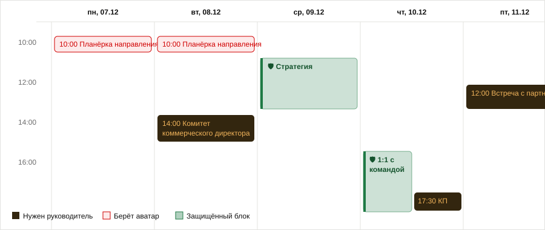
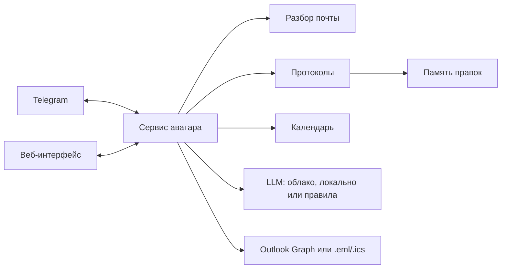

<p align="center"></p>

# Цифровой аватар руководителя онлайн-продаж


ИИ-помощник, который берёт на себя рутину руководителя: утренний план и чат в Telegram, разбор почты по правилам профиля, участие в встречах, протокол на утверждение, рассылку и задачи, а также защищает время в календаре. Решения по деньгам, кадрам и обязательствам клиентам всегда остаются за человеком.

## Возможности

| Блок | Что делает |
|---|---|
| План дня | Утренняя сводка и чат в Telegram, кнопки подтверждения |
| Почта | Разбор по правилам профиля, эскалация важных писем, защищённые категории не автоматизируются |
| Встреча | Аватар представляется ИИ, отвечает по задачам и целям, чувствительные вопросы передаёт руководителю |
| Протоколы | Черновик на утверждение, рассылка и задачи только после решения руководителя |
| Обучение | Правки руководителя превращаются в правила и применяются к следующим черновикам |
| Календарь | Защищённые блоки, конфликты и предложения переноса, оценка освобождённых часов |
| Второй руководитель | Новый профиль создаётся из формы или правкой `profile.md`, без программирования |



*Иллюстрация: защищённые блоки показаны прозрачно-зелёным, встреча в конфликте встаёт рядом с блоком.*

## Как это устроено



Без ключей всё работает на правилах. Подключение модели улучшает протоколы и ответы аватара.

## Быстрый старт

```bash
python -m venv .venv
source .venv/bin/activate        # Windows: .venv\Scripts\Activate.ps1
pip install -r requirements.txt
python run.py                    # http://127.0.0.1:8000
python -m unittest discover -s tests
```

## Настройка и внешний вид

- Подключение моделей, Telegram и Outlook: вкладка «Подключения». Ключи можно задать и переменными окружения, см. `.env.example`.
- Цвета, плотность и вид календаря: `docs/CUSTOMIZATION.md` и пример `docs/theme-example.css`.
- Правила разбора почты и защищённые блоки: разделы «Правила разбора» и «Защищённые блоки» в `profile.md`.

## Безопасность

- Категории из «Никогда без подтверждения» нельзя перевести в авто.
- Письмо отправляется только после решения руководителя, рассылка протокола только после утверждения.
- Перенос встречи в защищённый блок понижается до «спросить руководителя».
- Адреса и телефоны маскируются перед отправкой в облачную модель.
- Секреты и данные состояния исключены через `.gitignore`. Не публикуйте токены в issue и коммитах.

## Ограничения

- Нет прямых интеграций с МТС Линк, Zoom и Дион: картинка и голос аватара выводятся в звонок через виртуальную камеру.
- Реальные Telegram, Outlook Graph и облачные модели требуют ваших токенов.
- Часы экономии считаются по формуле из допущений, а не измеряются.

## Структура

```
app/            сервер, логика, веб-интерфейс (app/web)
data/           демо-данные и профили (состояние и секреты не коммитятся)
tests/          автотесты ядра
docs/           настройка внешнего вида и иллюстрации
```
