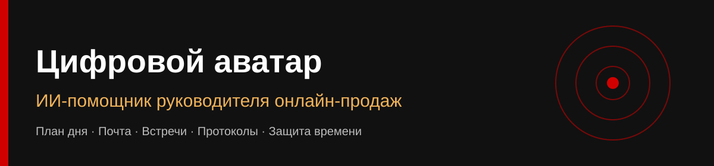
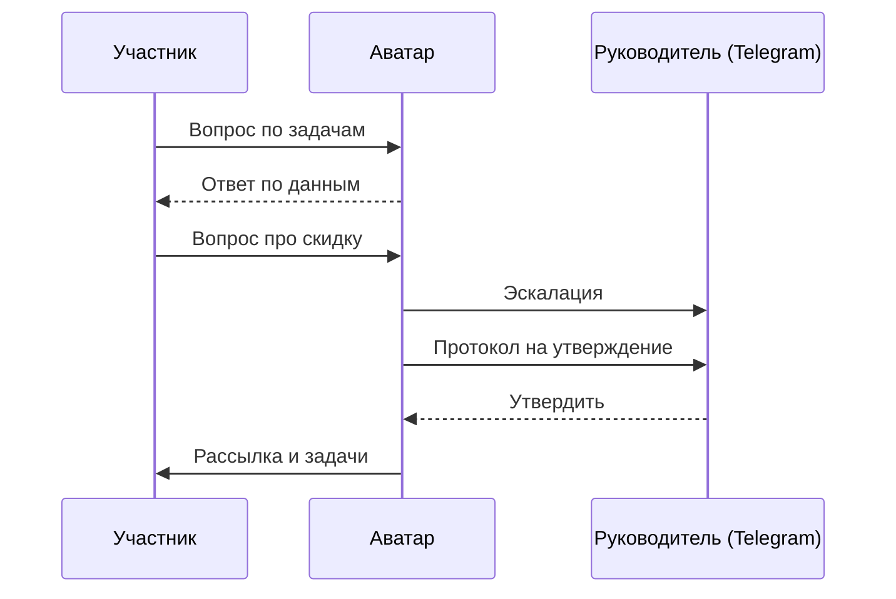
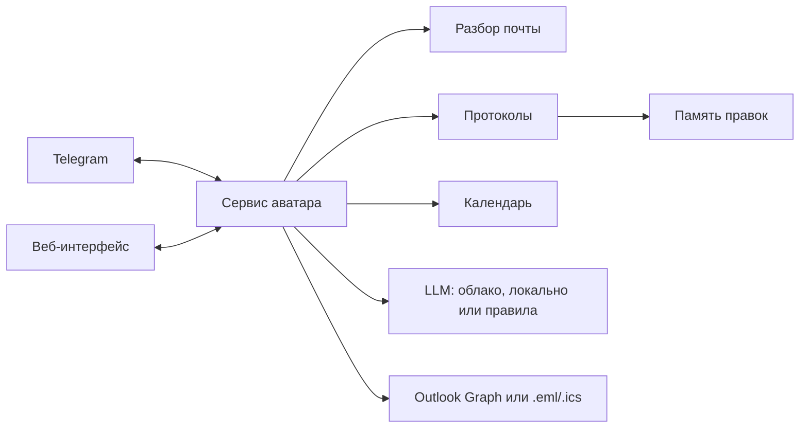

<p align="center"></p>

<h1 align="center">Цифровой аватар руководителя</h1>

<p align="center"><b>ИИ-помощник для руководителя онлайн-продаж: берёт рутину, решения оставляет человеку</b></p>

<p align="center">
  
  
  
  
  
</p>

<p align="center"><a href="#-зачем-это">Зачем</a> · <a href="#-возможности">Возможности</a> · <a href="#-человек-решает">Принцип</a> · <a href="#-быстрый-старт">Старт</a> · <a href="#-настройка">Настройка</a> · <a href="#-планы">Планы</a></p>

---

## 🎯 Зачем это

> Руководитель тратит часы на план дня, почту, протоколы и защиту календаря. Аватар готовит всё это заранее и просит подтверждения там, где нужен человек.

## ✨ Возможности

| | Блок | Что делает |
|---|---|---|
| 🌅 | **План дня** | Утренняя сводка и чат в Telegram, кнопки подтверждения |
| 📧 | **Почта** | Разбор по правилам профиля, эскалация важных писем |
| 🎤 | **Встреча** | Аватар представляется ИИ и отвечает по задачам и целям |
| 📝 | **Протоколы** | Черновик на утверждение, рассылка и задачи после решения руководителя |
| 🧠 | **Обучение** | Правки превращаются в правила и применяются к следующим черновикам |
| 🛡️ | **Календарь** | Защищённые блоки, конфликты, переносы, оценка освобождённых часов |
| 👥 | **Второй руководитель** | Новый профиль из формы или правкой `profile.md`, без программирования |

## 🤝 Человек решает

| Сам аватар | Только после подтверждения | Никогда сам |
|---|---|---|
| План дня, разбор почты по правилам, черновики, предложения переноса | Отправка письма, рассылка протокола, перенос встречи в защищённый блок | Деньги, кадры, обязательства клиентам: передаёт руководителю |



## 🏗️ Архитектура



## 🚀 Быстрый старт

```bash
python -m venv .venv
source .venv/bin/activate        # Windows: .venv\Scripts\Activate.ps1
pip install -r requirements.txt
python run.py                    # http://127.0.0.1:8000
python -m unittest discover -s tests
```

Без ключей всё работает на правилах. Модель улучшает протоколы и ответы аватара.

## 🎨 Настройка

- **Подключения:** модели, Telegram и Outlook во вкладке «Подключения», ключи также через `.env.example`.
- **Внешний вид:** цвета и прозрачность защищённых блоков — [docs/CUSTOMIZATION.md](docs/CUSTOMIZATION.md), палитра — [docs/theme-example.css](docs/theme-example.css).
- **Поведение:** разделы «Правила разбора» и «Защищённые блоки» в `profile.md`.

<details>
<summary><b>Структура проекта</b></summary>

```
app/            сервер, логика, веб-интерфейс (app/web)
data/           демо-данные (состояние и секреты не коммитятся)
tests/          автотесты ядра
docs/           настройка внешнего вида
assets/         баннер и превью
```

</details>

<details>
<summary><b>Ограничения</b></summary>

- Нет прямых интеграций с МТС Линк, Zoom и Дион: картинка и голос аватара выводятся в звонок через виртуальную камеру.
- Реальные Telegram, Outlook Graph и облачные модели требуют ваших токенов.
- Часы экономии считаются по формуле из допущений, а не измеряются.

</details>

## 🗺️ Планы

- [ ] Живая встреча: запись звука, расшифровка и протокол на утверждение
- [ ] Мастер подключения Telegram из интерфейса
- [ ] Реальный календарь Outlook вместо заглушки
- [ ] Разделение голосов участников встречи

---

<p align="center"><sub>Участие: <a href="CONTRIBUTING.md">CONTRIBUTING</a> · Безопасность: <a href="SECURITY.md">SECURITY</a> · Изменения: <a href="CHANGELOG.md">CHANGELOG</a> · Лицензия: MIT</sub></p>
